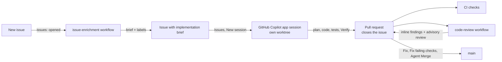

# Demo runbook

A 25-minute walk through an agent-assisted delivery loop on a small, real codebase: a backlog of
realistic issues, an agentic workflow that prepares each new issue, a GitHub Copilot app session
that builds it, an agentic review of the pull request, and Agent Merge to land it.

Everything you show is live. `demo/backlog/` holds only the human-written issue text; the briefs,
the code, and the reviews come from real workflow runs and agent sessions.

## What you are showing

| SDLC stage | How it usually goes | In this demo |
| --- | --- | --- |
| Plan and triage | A maintainer reads each new issue, labels it, and sketches an approach, or the issue waits | The **issue-enrichment** workflow appends an implementation brief and labels within minutes of the issue opening |
| Build | A developer finds the code, then writes the change and its tests | One app session per issue, in its own worktree, starting from the brief and `.github/copilot-instructions.md` |
| Review | The pull request waits for a teammate's first pass | The **code-review** workflow posts an advisory review on every pull request and every layer of a stack |
| Merge | Someone watches CI, answers comments, and resolves conflicts | **Agent Merge** does that from the app |



## Prepare once

| You need | Check |
| --- | --- |
| Node.js 22.12+ or 24+ | `node --version` |
| GitHub CLI signed in as the repository owner (or anyone with write access) with `repo` and `workflow` scopes | `gh auth status` |
| The repository connected in the GitHub Copilot app | In the sidebar, click **+** next to **Sessions**, then under **Start session in** choose **Add GitHub repository** |
| An Actions secret named `COPILOT_GITHUB_TOKEN` (fine-grained token with **Copilot Requests: Read**) | `gh secret list` |
| Both agentic workflows on the default branch (issue events only run workflows from there) | `gh workflow list` shows **Issue enrichment** and **Agentic code review** |

The first time the app sees `.github/github-app.yml` it asks you to review and accept the
repository configuration (the **Setup**, **Run**, and **Verify** scripts). Accept it before the demo.
It asks again after any change made outside the app, even to a comment.

## Reset before every demo

```powershell
npm ci
npm run demo:reset -- --dry-run   # prints the plan and changes nothing
npm run demo:reset                # asks y/N, then applies
```

The reset is idempotent. It:

- closes open pull requests, with a comment, and deletes their branches (the default branch,
  protected branches, and `demo/*` branches are kept);
- restores every issue from `demo/backlog/` to its seed text: title, body, labels, open, unassigned,
  no comments. It creates the ones that are missing;
- closes any other open issue as *not planned*, and creates missing labels.

| Option | What it does |
| --- | --- |
| `--enrich` | Starts the real **Issue enrichment** run for every restored issue, so the backlog already holds briefs. Each run takes a few minutes; start about 15 minutes before you present |
| `--reset-main` | After a demo that merged pull requests: force-resets the default branch to the `demo-baseline` tag. It lists the commits it discards and asks you to type the repository name |
| `--yes` | Skips the confirmation (required without a terminal) |
| `--repo owner/name` | Targets another repository |
| `--validate` | Checks the backlog files offline (CI runs this) |

An issue the reset has to *create* is enriched by the workflow as it opens, like any new issue. To
show an all-thin backlog, run the reset a second time (it restores the original text), or file
your own issue live as in step 2.

## Preflight (two minutes before)

- `gh issue list` shows the 12 backlog issues and `gh pr list` shows no open pull requests.
- **Actions** shows no runs you did not start.
- Open one issue and scroll to the end: it has a **🧭 Implementation brief** if you used `--enrich`,
  and none otherwise.
- In the app, **Issues** lists the backlog and the repository configuration is accepted. Optionally
  set **Tool permissions** to **Assisted** so the session does not pause on routine commands.

## The demo

### 1. The backlog (2 min)

In the app, click **Issues** in the sidebar (or run `gh issue list`).

Six accessibility findings written the way an auditor reports them, five feature requests written
the way people write them, and one deliberately vague question.

**What to observe:** the human-written part of each issue is short. Everything structured that you
see next comes from the workflow.

### 2. A new issue is prepared automatically (4 min; start this first)

```powershell
gh issue create --title "Add a waitlist when the dinner is sold out" --body "When the dinner is full, the reservation form only tells organizers to free seats or raise the capacity. People who ask late are turned away. Let organizers keep a waitlist for a sold-out dinner and offer those guests a seat when one frees up."
```

Talk through the backlog while the run works. A 👀 reaction appears within seconds; **Actions → Issue
enrichment** shows the run. After a few minutes the issue body ends with **🧭 Implementation brief**
and the issue has labels.

**What to observe:**

- Type, size, and readiness on one line, then a **Where this lands** table whose files exist.
  Open one.
- Acceptance criteria you could test, and a test plan that names the existing test files.
- Risks that cite the contracts in `.github/copilot-instructions.md` (cents, Canadian French,
  accessibility).
- For a large issue, a **Suggested stack** of independently reviewable layers.
- The workflow can only edit this one issue: a single body update and up to three labels from an
  allow-list. It treats the issue text as untrusted input.

Re-run it on any issue. The brief is replaced, never duplicated:

```powershell
gh workflow run issue-enrichment.lock.yml -f issue_number=<number>
```

### 3. A vague issue gets questions, not guesses (2 min)

Open **Volunteers page feels confusing** (re-run the workflow on it if it has no brief yet).

**What to observe:** the brief leads with open questions instead of inventing requirements. That is
the point of the **Readiness** field.

### 4. Pick it up in the app (8–10 min)

1. Click **Issues**, open an issue that has a brief (for example **Export the guest list as a CSV
   file**), and click **New session**. The session starts with the issue loaded.
2. Use a **New worktree** as the workspace (its own branch, isolated from your checkout; **Setup**
   runs `npm ci`) and choose **Plan** mode.
3. Prompt: `Implement this issue, following the implementation brief.` Review the plan, then approve it.
4. Watch the session read the brief and `.github/copilot-instructions.md`, change the code, add
   tests, and run **Verify**.
5. Start the **Run** script. The dev server starts and the app opens it in the integrated browser.
   Try the feature.
6. Prompt: `Open a pull request that closes this issue.` The agent follows
   `.github/pull_request_template.md`.

**What to observe:** the plan restates the brief's acceptance criteria. Tests land next to the code
they cover. Money stays in integer cents, UI text stays in Canadian French, and the pull request is
small and references the issue.

Open the pull request as early as you can: the review in step 5 takes a few minutes.

### 5. The pull request is reviewed automatically (4 min)

Click **Pull requests** in the sidebar and open the new pull request. The overview shows the summary,
CI check results, and review activity. **App checks** and **Agentic code review** start on their own.

When the review lands there is one advisory review plus inline findings. Click **Fix** on a comment
to hand it to the session, or **Fix failing checks** if CI failed.

**What to observe:** findings cite files and lines and come from the whole diff and the code around
it. The reviewer says what it could not verify instead of declaring the change clean. It cannot
approve, request changes, edit branches, or merge. A new commit cancels the older run and reviews
again.

### 6. Agent Merge lands it (2 min)

Enable **Agent Merge** at the top of the app. It prompts the pull request's session to fix what
blocks the merge (failing checks, review comments, conflicts) and to merge as soon as GitHub allows.
It runs in the background and turns itself off after the merge.

Enable it once the review has landed: this repository has no required checks, so GitHub allows the
merge as soon as Agent Merge asks.

### 7. Optional: an epic as a stack (5 min)

Open **Event-day operations: check-in, table planning and a service report**. Its brief is sized as
a stack and proposes layers. In a new session, ask the agent to implement those layers as dependent
pull requests. The app creates one session per layer and links the pull requests as a GitHub Stack,
and the code review covers every layer.

## After the demo

```powershell
npm run demo:reset -- --reset-main   # --reset-main only if pull requests were merged
```

Then archive the demo sessions: open the app settings, click **Sessions**, then **Manage sessions**,
select them, and archive (this also removes their worktrees). To rehearse again, start at *Reset
before every demo*.

## Troubleshooting

| Symptom | Cause and fix |
| --- | --- |
| No 👀 and no run after filing an issue | Issue workflows only run from the default branch, and only for people with write access. Check `gh workflow list` and that Actions is enabled |
| The run fails in the agent step with an authentication error | `COPILOT_GITHUB_TOKEN` is missing or expired, or its owner has no Copilot access to the model. Create a new fine-grained token (**Copilot Requests: Read**) and update the secret |
| An issue has no brief after a reset | Expected: the reset restores the thin seed. Use `--enrich`, or run `gh workflow run issue-enrichment.lock.yml -f issue_number=<number>` |
| The review did not run on a pull request | Fork pull requests and people without write access are excluded. Check **Actions → Agentic code review**; a newer commit cancels the older run |
| **Setup** does not run in a new session | Accept the repository configuration in the app (`.github/github-app.yml`) |
| `--reset-main` says the tag does not exist | Create the baseline: `git tag demo-baseline <commit>`, then `git push origin demo-baseline` |
| `demo:reset` fails with an authentication or 404 error | Run `gh auth login` (the `repo` scope is required), or pass `--repo owner/name` |

## Questions you may get

- **Is it safe to let an agent edit issues?** The agent has read-only access. It publishes through
  two declared safe outputs, one body update and one label call, both locked to the triggering
  issue, and only for actors with write access.
- **Why not only the app's Automations?** They can also react to repository events. This repository
  uses GitHub Agentic Workflows because the definition lives in the repository, is reviewed and
  pinned like code, and runs on Actions with explicit permissions.
- **What does it cost?** Each run uses the Copilot allowance of the `COPILOT_GITHUB_TOKEN` owner.
  App sessions use the signed-in account's allowance.
- **Can the reviewer block a merge?** No. It leaves advisory `COMMENT` reviews only.

## What is where

| Path | Purpose |
| --- | --- |
| `.github/workflows/issue-enrichment.md` | Agentic workflow source: appends the brief and labels. Its `.lock.yml` is generated |
| `.github/workflows/code-review.md` | Agentic workflow source: advisory pull request review. Its `.lock.yml` is generated |
| `.github/workflows/ci.yml` | Lint, tests, build, backlog validation, and a check that compiled workflows are current |
| `.github/copilot-instructions.md` | Conventions every agent session and both workflows read |
| `.github/github-app.yml` | GitHub Copilot app scripts: Setup, Run, Verify |
| `.github/pull_request_template.md` | Pull request structure that agent sessions follow |
| `.github/aw/actions-lock.json` | Pinned action versions used by the compiled workflows |
| `demo/backlog/` | The 12 issue seeds and the format guide |
| `demo/reset.mjs` | The reset command (Node, no dependencies; the header documents every step) |
| `src/` | The app: see the architecture section of the [README](README.md) |

## Maintain the demo

- **Change or add a backlog issue:** edit `demo/backlog/`, run `npm run demo:reset -- --validate`,
  merge, then run the reset. The format is in `demo/backlog/README.md`.
- **Change a workflow:** edit its `.md` file, recompile as described in the [README](README.md), and
  commit the source, the `.lock.yml`, and `.github/aw/actions-lock.json` together. Then run it on
  an issue to check the output.
- **Move the baseline** after merging anything that should survive a reset (for example a better
  workflow prompt):

  ```powershell
  git tag -f demo-baseline <commit>
  git push -f origin demo-baseline
  ```
